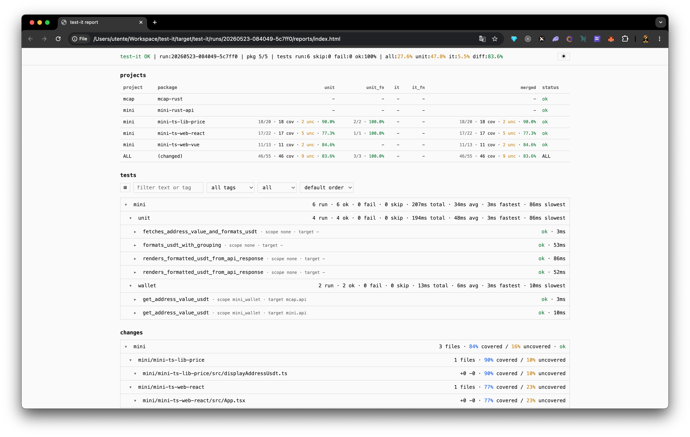

<div align="center">
<pre>
     ╱▓▓▓▓▓       ██████╗  ██╗  ██╗  ███████╗  ██████╗   ██████╗   ██╗   ██╗  
    ╱   ╲        ██╔════╝▒ ██║▒ ██║▒ ██╔════╝▒ ██╔══██╗  ██╔══██╗  ╚██╗ ██╔╝▒ 
   ╱    ▄▀▀▀▄    ██║▒▒▒▒▒▒ ███████║▒ █████╗▒▒▒ ██████╔╝▒ ██████╔╝▒  ╚████╔╝▒▒ 
▄▀▀▀▄   ▌   ▐▒   ██║▒      ██╔══██║▒ ██╔══╝▒   ██╔══██╗▒ ██╔══██╗▒   ╚██╔╝▒▒  
▌   ▐▒  ▀▄▄▄▀▒   ╚██████╗  ██║▒▒██║▒ ███████╗  ██║▒▒██║▒ ██║▒▒██║▒    ██║▒▒   
▀▄▄▄▀▒   ▒▒▒▒▒    ╚═════╝▒ ╚═╝▒ ╚═╝▒ ╚══════╝▒ ╚═╝▒ ╚═╝▒ ╚═╝▒ ╚═╝▒    ╚═╝▒    
 ▒▒▒▒▒             ▒▒▒▒▒▒▒  ▒▒▒  ▒▒▒  ▒▒▒▒▒▒▒▒  ▒▒▒  ▒▒▒  ▒▒▒  ▒▒▒     ▒▒▒    
                          ████████╗  ███████╗  ███████╗  ████████╗            
                          ╚══██╔══╝▒ ██╔════╝▒ ██╔════╝▒ ╚══██╔══╝▒           
                           ▒▒██║▒▒▒▒ █████╗▒▒▒ ███████╗▒  ▒▒██║▒▒▒▒           
                             ██║▒    ██╔══╝▒   ╚════██║▒    ██║▒              
                             ██║▒    ███████╗  ███████║▒    ██║▒              
                             ╚═╝▒    ╚══════╝▒ ╚══════╝▒    ╚═╝▒              
                              ▒▒▒     ▒▒▒▒▒▒▒▒  ▒▒▒▒▒▒▒▒     ▒▒▒              

                       Multiple mono-repositories. Single test workflow.
</pre>
A unified test framework for monorepos and multi-repository workspaces.
</div>

# Cherry Test

**Run unit, integration, functional, and visual tests, plus coverage, across monorepos and multi-repository workspaces.**

Code lives in a single repository or in several repositories side by side, and those trees are written in more than one technology. Cherry Test is a unified test framework for that layout. One run executes unit, integration, functional, and visual tests and collects coverage, whether the packages sit in one repository or in many. You review failures, skips, and coverage in the terminal and in a browser report, with no IDE required.

It currently supports Rust, Node.js, React and Vue frontends, and Kotlin, Java, and C++ backends.

Use it locally while building a feature, or in CI/CD before merging into a development or production branch. It gives reviewers evidence to check code written by people and AI agents: what ran, what failed, what changed, and where tests leave gaps.

The GitHub repository is [`lmrrcc/cherry-test`](https://github.com/lmrrcc/cherry-test). Run the Rust edition with `cherry-test` or `cargo cherry-test`, or the [Java 25 edition](java/README.md) with `cherry-test-java`. Both editions use `cherry-test.yaml`; their report compatibility checks are documented in [the parity results](java/PARITY.md).



## Contents

- [Why use Cherry Test?](#why-use-cherry-test)
- [What is supported?](#what-is-supported)
- [Install](#install)
- [Quick start](#quick-start)
- [Monorepos and multiple repositories](#monorepos-and-multiple-repositories)
- [Configuration](#configuration-testyaml)
- [Integration tests, mocks, and test containers](#integration-tests-mocks-and-test-containers)
- [Coverage and browser reports](#coverage-and-browser-reports)
- [Review AI-written code in CI/CD](#review-ai-written-code-in-cicd)
- [Mutation testing](#mutation-testing)
- [CRAP score](#crap-score)
- [Command reference](#command-reference)
- [Run files and environment variables](#run-files-and-environment-variables)
- [Current limits](#current-limits)
- [Development](#development)

## Why use Cherry Test?

A change to one service can break another package or application. Cherry Test helps you test those parts together and review the result in one place.

- **Mixed technologies:** run Rust, Java, Kotlin, C, C++, JavaScript, and TypeScript tests in the same configured flow.
- **Multiple projects:** group packages by application or service, including code held in nested Git repositories or submodules.
- **Real service connections:** start containers for APIs, databases, and other dependencies used by integration tests.
- **Coverage you can inspect:** combine LCOV data and compare it with the code changed since a chosen Git base.
- **A report you can browse:** expand projects, suites, and files; inspect failures and coverage gaps directly in a browser.
- **Evidence before a merge:** keep reports as CI artifacts so a reviewer can check the same results as the author or coding agent.

One configuration root produces one combined report. Independent configuration roots produce separate runs and reports. See [workspace layouts](#monorepos-and-multiple-repositories) for the current Rust workspace requirements.

## What is supported?

| Area | Support today |
| --- | --- |
| Rust | Unit and integration tests through Cargo; coverage through `cargo-llvm-cov` |
| JavaScript and TypeScript | Vitest tests, JSON results, and LCOV coverage |
| Java and Kotlin | Maven or Gradle, JUnit XML results, and JaCoCo source coverage |
| C and C++ | CMake/CTest, Unity or GoogleTest, and LLVM source coverage |
| React and Vue | Vitest unit tests and real Playwright functional and screenshot tests |
| Browser tests | Playwright results, screenshots, expected/actual/diff images, and trace attachments |
| Other test commands | A `functional` runner can launch an external command and use its exit status |
| Test containers | Docker Compose starts the configured service stacks for scoped integration tests |
| Mocks | Use mocks from your test framework, or run a mock service in Compose |
| Reports | Terminal summary, HTML report, LCOV files, and recorded integration requests |
| Mutation testing | Use an external tool alongside Cherry Test; no built-in mutation report yet |
| CRAP scoring | Calculated on a normal run from cyclomatic complexity and line coverage. `--no-crap` skips it |

Adapters can run local tools or container toolchains. Add an external executable adapter to support another language without rebuilding Cherry Test. See [language adapters](docs/adapters.md) and the [six-backend price sample](app/mini/polyglot/README.md).

## Install

Install from this repository with Cargo:

```bash
cargo install --git https://github.com/lmrrcc/cherry-test --branch main --locked --bins cherry-test
```

Make sure Cargo's binary directory, usually `~/.cargo/bin`, is on your `PATH`.

Or build from a local checkout:

```bash
git clone https://github.com/lmrrcc/cherry-test.git
cd cherry-test
cargo install --path test/cherry-test --locked --bins
```

From inside this checkout, you can also use `cargo cherry-test` without installing the binary.

### Tools you need

| Tool | When you need it |
| --- | --- |
| Rust and Cargo | To build Cherry Test and run Rust packages |
| Git | To discover code changes and compare branches |
| Node.js and your package manager | To install and run Vitest or Playwright packages |
| `cargo-llvm-cov` and LLVM tools | To collect Rust coverage |
| A Vitest coverage provider | To collect coverage for Node packages |
| Docker with Compose | To run the configured container services |
| A web browser | To open the HTML report |

Set up Rust coverage with:

```bash
cargo install cargo-llvm-cov --locked
rustup component add llvm-tools-preview
```

Install your Node dependencies before running Cherry Test. For example, use `pnpm install` in a pnpm workspace. Match the Vitest coverage provider version to the Vitest version used by your project. Browser tests also need the browsers required by your Playwright configuration.

### Update

Use the explicit repository URL:

```bash
cherry-test update --repo https://github.com/lmrrcc/cherry-test --branch main
```

The updater and `install.sh` default to `lmrrcc/test`. Use `--repo`, or set `CHERRY_TEST_REPO`, to select a different checkout.

## Quick start

### Use Cherry Test in your project

From the root of your project:

```bash
cherry-test --init-only
```

This creates `cherry-test.yaml` from the packages and services Cherry Test discovers. Review the paths, test kinds, and Docker scopes, then run:

```bash
cherry-test
```

By default, Cherry Test collects coverage and opens the HTML report. To keep the report without opening a browser:

```bash
cherry-test --no-open
```

With the default output settings, open `target/cherry-test/latest/reports/index.html` to browse the latest run. The terminal also prints the report path.

Running `cherry-test` without an existing configuration also creates one and starts the tests immediately.

### Try the bundled sample

The `app/mini` submodule combines Rust services, a database, and TypeScript packages, including React and Vue examples.

From this repository's root:

```bash
git submodule update --init app/mini
pnpm --dir app/mini install
cargo cherry-test --root app/mini --no-open
```

Start Docker before running the container tests. The sample has its own configuration and Cargo workspace, so use `--root app/mini` explicitly. Its report is written under `app/mini/target/cherry-test/` with the sample's default settings. Some sample scenarios need additional environment settings; review [the sample configuration](app/mini/cherry-test.yaml) first.

### Try Shop

[Shop](https://github.com/lmrrcc/shop) is a separate repository checked out at `app/shop`. It is one configuration root: a Rust API, a TypeScript cart library, a React storefront, and Postgres.

```bash
git submodule update --init app/shop
cp app/shop/.env.example app/shop/.env
pnpm --dir app/shop install
cargo cherry-test --root app/shop --no-open
```

## Monorepos and multiple repositories

A **monorepo** keeps several packages or applications in one Git repository. A **multi-repository workspace** keeps separate Git checkouts together, often as submodules. Cherry Test groups packages into projects and can inspect Git changes inside those nested repositories.

For example, a workspace can contain:

```text
workspace/
  cherry-test.yaml
  Cargo.toml
  services/
    orders/          Rust service
    payments/        Rust service
  apps/
    storefront/      TypeScript application
  packages/
    shared-ui/       Shared frontend package or Git submodule
```

Define each group under `projects`, then list its packages. A scope can name several projects so an integration test can connect their services.

Rust packages in one run must be reachable through Cargo from that configuration root. Setting `manifest` helps discovery; it does not switch the Rust runner to another Cargo workspace. If your repositories have independent Rust workspaces, keep a `cherry-test.yaml` in each one and run each root explicitly:

```bash
cherry-test --root services/orders --no-open
cherry-test --root services/payments --no-open
```

Each of those runs has its own report. Cherry Test does not clone repositories or merge reports from independent configuration roots. Check out the code before running it, and use a shared root configuration when the packages can run together.

## Configuration (`cherry-test.yaml`)

Put `cherry-test.yaml` beside the workspace it describes. Paths in the configuration are relative to that root, including `manifest`, `compose`, and runner `cwd` paths.

This example describes a Cargo workspace with an `orders-api` library crate and a Vitest package named `storefront`:

```yaml
defaults:
  coverage: true
  html_report: true
  open_report: true
  runs_base: target/cherry-test/runs
  scope: global
  diff_base: main

projects:
  shop:
    path: .
    compose: docker-compose.test.yml
    packages:
      orders-api:
        manifest: services/orders-api/Cargo.toml
        kinds: [unit, integration]
      storefront:
        runtime: node
        manifest: apps/storefront/package.json
        kinds: [unit]
        unit:
          command: pnpm
          args: [exec, vitest, run, --coverage]
          cwd: apps/storefront
    services:
      api:
        service: orders-api
        port: 3000
        health: /health
      db:
        service: shop-db
        port: 5432
        kind: postgres

scopes:
  checkout:
    projects: [shop]
```

The package names must match their Cargo or npm manifests. The Compose service names must match your `docker-compose.test.yml`. Add health checks to that file so Compose can tell when dependencies are ready.

### Main settings

| Setting | Meaning |
| --- | --- |
| `defaults.coverage` | Collect coverage; default is `true` |
| `defaults.html_report` | Write the browser report; default is `true` |
| `defaults.open_report` | Open the report after a local run; default is `true` |
| `defaults.runs_base` | Directory for run files; default is `target/cherry-test/runs` |
| `defaults.diff_base` | Git reference to compare against; default is `main` |
| `defaults.scope` | Default integration scope: `global`, `none`, a project ID, or a named scope |
| `defaults.coverage_ignore` | Coverage exclusion file; default is `.coverageignore` |
| `projects.<id>.diff_base` | Override the Git base for one project |
| `projects.<id>.packages.<name>.kinds` | Test kinds: `unit`, `integration`, `functional`, `visual`, `ui`, or `mutation` |
| `scopes.<name>.projects` | Projects whose Compose stacks a scope needs |

`cherry-test.yml` and `cherry-test.toml` are also accepted.

### Configure Vitest output

Cherry Test passes `VITEST_JSON_REPORT` and, when coverage is enabled, `VITEST_COVERAGE_DIR` to Vitest. Your Vitest configuration must use them to write results into the current run:

```ts
import { defineConfig } from "vitest/config";

const jsonReport = process.env.VITEST_JSON_REPORT;
const coverageDir = process.env.VITEST_COVERAGE_DIR;

export default defineConfig({
  test: {
    reporters: jsonReport ? ["default", "json"] : ["default"],
    outputFile: jsonReport ? { json: jsonReport } : undefined,
    coverage: {
      provider: "v8",
      enabled: Boolean(coverageDir),
      reportsDirectory: coverageDir ?? "coverage",
      reporter: ["lcov", "text"],
    },
  },
});
```

Merge these settings into your existing configuration. Keep any environment, plugin, or setup settings your tests need. The Node runner uses the local Vitest installation in the configured working directory.

### External and browser tests

Add a `functional` or `ui` block to a package, and include that kind in its `kinds` list. These blocks use `command`, `args`, and `cwd`, like the `unit` block above.

Choose an adapter on each phase, such as `adapter: playwright` for browser tests. Results and screenshot attachments are imported into the browser report. The command adapter supports legacy exit-status checks in non-strict runs; strict runs require individual test results. See the [adapter guide](docs/adapters.md) for configuration and the executable protocol.

### Discovery

`cherry-test --init-only` discovers Cargo, Vitest, Maven, Gradle, and CMake packages, common Compose filenames, and scopes found in `#[cherry_test]` tests. It scans up to six directory levels and skips folders such as `.git`, `target`, and `node_modules`.

Use `cherry-test --force-init` to regenerate a configuration. This rewrites `cherry-test.yaml`, so review the resulting diff. For an unusual layout, edit the configuration directly and select it with `--root`.

## Polyglot example

The sample has equivalent Rust, Java/Spring, Kotlin/Spring, Kotlin/Ktor, C, and C++ price backends. The same contract checks each implementation against PostgreSQL. React and Vue browser tests then exercise the real wallet API with each backend.

```bash
python3 app/mini/polyglot/tools/prepare.py
cargo cherry-test prices --root app/mini --execution container --strict --no-open
```

Use `--kinds unit,integration`, `--kinds functional`, or `--kinds visual` to select phases. `--kinds mutation` runs the external mutation tools configured on the sample packages and is not part of a default run. Open the generated report and follow **Test phases** to inspect screenshots and covered or uncovered source lines. [Full sample instructions](app/mini/polyglot/README.md).

## Integration tests, mocks, and test containers

Unit tests check small pieces of code. Integration tests check how those pieces connect. End-to-end tests check a complete flow, such as a browser request reaching an API and saving a record in a database.

Cherry Test uses Docker Compose to start the services needed by scoped integration tests. It runs Compose with `up -d --build --wait`, discovers mapped service ports, and makes the endpoints available to the tests. After the run, it requests teardown of the started stacks and their volumes. Use dedicated test data and test containers.

Add these test dependencies to the Rust package's `Cargo.toml` to use `TestEnv` and the `#[cherry_test]` macro:

```toml
[dev-dependencies]
anyhow = "1"
cherry-test-core = { git = "https://github.com/lmrrcc/cherry-test", branch = "main" }
tokio = { version = "1", features = ["macros", "rt-multi-thread"] }
```

The macro uses `tokio` and `anyhow` in the consuming package. Commit your lockfile so the resolved dependencies can be reproduced in CI.

With the `shop` configuration above, a test under the Rust package's `tests/` directory can look like this:

```rust
use cherry_test_core::prelude::*;

#[cherry_test(scope = "checkout")]
async fn shop_project_api_suite_health_test(env: TestEnv) {
    let response = env
        .project("shop")
        .service("api")?
        .get("/health")
        .send()
        .await;
    response.assert_status(200);
}
```

This is a connectivity check. Build end-to-end tests on top of it with assertions about real behavior: returned values, saved records, permissions, and error paths.

The macro requires an async function with one `env: TestEnv` argument and no declared return type. It supports `?` inside the test body. Test names follow:

```text
{project}_project_{suite}_suite_{test}_test
```

The project segment must identify a configured project. These tests are marked ignored for ordinary Cargo runs; Cherry Test selects them during its integration phase.

### Mocks and real dependencies

Use your test framework's mocks to exercise cases such as timeouts or an unavailable third-party API. A mock server can also be a service in your Compose file. Cherry Test runs the tests and services you configure; it does not generate mocks or provide a dedicated Testcontainers library adapter.

For a real end-to-end check, run the actual services and database involved in the flow. Use browser tests when the user interface is part of that flow. A test with a mocked dependency only verifies the behavior represented by that mock.

**If Docker is unavailable, Cherry Test records scoped integration tests as skipped.** Non-strict runs can succeed with skips. Use `--strict` in CI to fail when required tests are skipped, and check that Docker is ready before starting.

## Coverage and browser reports

Cherry Test collects Rust coverage with `cargo-llvm-cov`, Node coverage through Vitest, JVM coverage through JaCoCo, and native C/C++ coverage through LLVM. It converts and combines LCOV files, with summaries by package, project, and test phase. LCOV is a text format that records coverage, including which source lines ran during tests.

The HTML report opens directly in a browser. Its styles and controls are included in the file, so reading the report does not require an IDE, editor extension, or report server.

| Report area | What you can inspect |
| --- | --- |
| Run summary | Overall package status, recorded test counts, coverage, and run identity |
| Projects | Package results and unit, integration, and combined coverage |
| Tests | Recorded pass, fail, and skip results, timing, filters, and failure reasons |
| Test details | HTTP information and source snippets when available |
| Changes | Expandable project and file diffs, line numbers, and coverage markers |

Coverage markers distinguish covered lines, uncovered lines, and lines without coverage information. The report helps you find issues such as failing tests and untested changes. Coverage records code execution; a covered line still needs useful assertions to verify its behavior.

### Review the code that changed

Set `diff_base` to the branch or commit you want to compare with. It can also be overridden per project, including projects in nested Git repositories. Changed-file discovery includes committed changes since that base, staged changes, unstaged changes, and untracked files.

For a pull request targeting a development branch, for example:

```yaml
defaults:
  diff_base: origin/development
```

Fetch the reference before running Cherry Test. Use `empty`, `empty-tree`, or `root` as the base to compare the tracked tree against an empty Git tree. File diffs are shown where a unified diff can be rendered.

### Exclude files from coverage

Create `.coverageignore` at the configuration root to exclude generated files or other files that should not contribute to coverage summaries. For example:

```text
**/generated/**
```

Keep exclusions narrow and review changes to this file along with changes to tests. Exclusions change the meaning of the reported coverage.

## Review AI-written code in CI/CD

Use Cherry Test as part of the checks required before merging into development or production. The report gives a reviewer concrete evidence to examine, whether a change was written by a person or an AI agent.

1. Check out the proposed code, submodules, and the target branch's Git history.
2. Install the project dependencies and coverage tools.
3. Start Docker when integration tests need containers.
4. Run `cherry-test --strict --no-open` from the intended configuration root.
5. Save the HTML report, coverage files, and test records as CI artifacts, including on failure.
6. Review failed or skipped tests, uncovered changes, and the assertions protecting the changed behavior.
7. Require the CI checks and code review to pass before allowing a merge.

For example, this Bash step assumes Cherry Test and the project dependencies are already installed. It requires Rust coverage and Docker, and checks that the default report files were created:

```bash
set -euo pipefail
export CI=true

cargo llvm-cov --version
docker info >/dev/null
docker compose version

cherry-test --strict --no-open

test -s target/cherry-test/latest/reports/index.html
test -s target/cherry-test/latest/coverage/merged.lcov
```

Run it in a fresh CI checkout with `coverage: true` and `html_report: true`. Use your CI provider's artifact step even if the test step fails. Upload the actual run directory's `reports/` and `coverage/` folders under `target/cherry-test/runs/`; `latest` is a local symlink. Adjust paths if your configuration uses another output directory.

**The command's success status is only one part of a merge decision.** Strict mode rejects failed or skipped tests, empty required phases, and missing requested coverage. Report-generation failures also fail the run. Review the configured package and phase selection: a successful run only covers the tests you selected. Set any minimum coverage or mutation score in a separate CI check.

Define your merge policy in CI: expected packages and tests, allowed skips, and required coverage. `--strict` rejects skips, empty phases, missing requested coverage, and invalid adapter results. A normal run reports CRAP. A high score does not fail the run. Minimum-coverage and mutation-score gates still need separate checks. Configure those additional checks separately and make the resulting CI jobs required checks in your repository settings.

When reviewing AI-written code, examine changes to the tests and configuration too. A removed assertion, a new exclusion, or a narrowed package selection can make a result look better without improving the code. Use the report alongside source review and any security or dependency checks your project requires.

## Mutation testing

Mutation testing checks whether tests notice small changes to the program. A tool might change `>` to `>=`, replace a return value, or remove an operation, then rerun the tests. A detected change is often called a **killed mutant**; a change that leaves the tests passing is a **surviving mutant**. See [Stryker's explanation of mutant results](https://stryker-mutator.io/docs/mutation-testing-elements/mutant-states-and-metrics/).

This helps find weak assertions even in code with high line coverage. Surviving mutants need review: some reveal missing tests, while others do not change the observable behavior.

**Current status:** Cherry Test does not create mutants, calculate a mutation score, or include mutant details in its HTML report. A normal run does not start mutation. Pass `--kinds mutation` to run the `mutation` command configured on each package. That command uses the tool's own exit status. Cherry Test does not collect mutation output as coverage.

| Environment | Tool | Sample package |
| --- | --- | --- |
| Rust | [`cargo-mutants`](https://mutants.rs/getting-started.html) | `mini-rs-lib-mcap` |
| C | [Mull](https://mull.readthedocs.io/en/latest/Installation.html) | `mini-c-mcap` |
| C++ | [Mull](https://mull.readthedocs.io/en/latest/Installation.html) | `mini-cpp-mcap` |
| Java | [PIT](https://pitest.org/) | `mini-java-spring-mcap` |
| Kotlin | [PIT](https://pitest.org/) | `mini-kotlin-spring-mcap`, `mini-kotlin-ktor-mcap` |
| Node | [StrykerJS](https://stryker-mutator.io/docs/stryker-js/introduction/) | `mini-ts-lib-price` |
| React | [StrykerJS](https://stryker-mutator.io/docs/stryker-js/introduction/) | `mini-ts-web-react` |
| Vue | [StrykerJS](https://stryker-mutator.io/docs/stryker-js/introduction/) | `mini-ts-web-vue` |

Install the tools beside Cherry Test, then run the phase:

```bash
cargo install cargo-mutants --locked
cherry-test --root app/mini --kinds mutation --no-open
```

C and C++ need `mull-runner` and the matching `mull-ir-frontend` compiler plugin. Java uses the `mutation` Maven profile. Kotlin uses Gradle with `polyglot/tools/pitest.init.gradle.kts`, which leaves the locked unit-test classpath unchanged. Node, React, and Vue use `@stryker-mutator/core` and `@stryker-mutator/vitest-runner`. A missing tool fails that package. Keep the tool's report beside the Cherry Test report, and use the mutation tool's own failure policy for merge checks.

## CRAP score

**CRAP** means **Change Risk Anti-Patterns**. The score combines a function's complexity and test coverage to help identify code that may be hard to change safely. A function with many decision paths and little coverage receives a higher score. See [the metric's original explanation by Alberto Savoia](https://testing.googleblog.com/2011/02/this-code-is-crap.html).

The formula, with coverage expressed as a fraction from `0` to `1`, is:

```text
CRAP = complexity^2 * (1 - coverage)^3 + complexity
```

Here, complexity is cyclomatic complexity, a measure of independent paths through a function. For complexity `10`, the formula gives `110` at no coverage, `22.5` at half coverage, and `10` at full coverage. The original metric uses basis-path coverage; tools can use different coverage measures, so check their definitions before comparing scores.

Use a high score to focus review, simplify complex functions, or add tests. The score does not prove that a function is correct.

**Current status:** A normal run calculates cyclomatic complexity and reports CRAP for each function in measured source. Pass `--no-crap` to skip that calculation. The aggregate LCOV percentage is not a CRAP score.

Coverage in the score is the fraction of measured lines inside the function. That is line coverage, not the original basis-path coverage. Complexity starts at 1 and adds one for each `if`, loop, `catch`, switch `case`, match arm, `&&`, `||`, and ternary. Rust, C, C++, Java, Kotlin, JavaScript, TypeScript, and Vue script blocks are scored. Crap load is 0 when the score is under 30, and `complexity * (1 - coverage) + complexity / 30` when the score is at or above 30. A score of exactly 30 counts. The report shows each function's complexity, measured-line coverage, CRAP, and crap load, then the workspace totals: function count, total complexity, total CRAP, mean, median, worst score, the count and percent at or above 30, and total crap load. Those totals are repeated per project when each scored file falls under one configured project path. Files outside every project are labeled outside projects. A high score does not by itself fail the run.

```bash
cherry-test --root app/mini --no-open
cherry-test --root app/mini --no-crap --no-open
```

## Command reference

```bash
cherry-test
cherry-test shop
cherry-test orders-api
cherry-test --root /path/to/workspace --no-open
cherry-test --no-coverage --no-open
cherry-test -- --nocapture
```

| Option | Purpose |
| --- | --- |
| `<filter>` | Select a project ID or package name |
| `--root <path>` | Select a configuration root explicitly |
| `--init-only` | Create or load the configuration, then exit without running tests |
| `--force-init` | Regenerate `cherry-test.yaml` from discovery |
| `--no-coverage` | Run without collecting coverage |
| `--kinds <list>` | Run only these phases. `mutation` runs only when it is named |
| `--no-crap` | Skip cyclomatic complexity and the CRAP report |
| `--no-html` | Skip HTML generation |
| `--no-open` | Write the report without opening a browser |
| `--no-banner` | Skip the startup banner |
| `-q`, `--quiet` | Reduce terminal output |
| `-v`, `--verbose` | Print each suite and test, with a check for a pass and a cross for a failure |
| `-- <args>` | Forward arguments to Rust's test harness |
| `--help` | Show the full CLI help |

Inside this repository, replace `cherry-test` with `cargo cherry-test` to run from source.

## Run files and environment variables

Each run gets its own directory:

```text
target/cherry-test/
  latest -> runs/<run-id>/
  runs/<run-id>/
    coverage/
      <project>/
      merged.lcov
    reports/
      index.html
      phases.html
      integration/*.jsonl
      adapters/<project>/<package>/<phase>/
        request.json
        result.json
        coverage.lcov
        ...logs, screenshots, and build output
    env.json
```

Files are created for the runners and features used in that run. `coverage/` holds per-package and merged LCOV files. `reports/` holds the browser report, integration records, and adapter results. `env.json` records service endpoints discovered by the core runtime.

Each run keeps its own build output, which can take several gigabytes. Remove completed runs when you no longer need them. When saving a report elsewhere, keep its adapter results and attachments; rebuildable `target/` and `build/` directories can be left out.

The `latest` symlink is available on Unix. On other systems, use the run path printed in the terminal. Keep generated files out of Git.

| Variable | Purpose |
| --- | --- |
| `CHERRY_TEST_WORKSPACE_ROOT` | Override the configuration root |
| `CHERRY_TEST_SKIP_COVERAGE=1` | Disable coverage collection |
| `CHERRY_TEST_NO_OPEN=1` | Disable automatic browser opening |
| `CHERRY_TEST_SKIP_DOCKER=1` | Bypass container startup and use supplied service endpoints; scoped test selection still depends on Docker preflight |
| `CHERRY_TEST_{PROJECT}_{SERVICE}_HOST` | Service host exported after startup |
| `CHERRY_TEST_{PROJECT}_{SERVICE}_PORT` | Mapped service port exported after startup |
| `CHERRY_TEST_{PROJECT}_{SERVICE}_URL` | HTTP service URL exported after startup |
| `CHERRY_TEST_RUN_DIR` | Current run directory, set by Cherry Test |
| `CHERRY_TEST_REPORT_DIR` | Current report directory, set by Cherry Test |
| `VITEST_JSON_REPORT` | JSON output path passed to Vitest |
| `VITEST_COVERAGE_DIR` | Coverage output directory passed to Vitest |
| `RUST_LOG` | Tracing filter, such as `cherry_test=info` |
| `NO_COLOR` | Disable terminal colors |

The runner loads `.env.test` from the configuration root when present, or from the project-ID directory. CI environments suppress automatic browser opening.

## Current limits

- **Docker skips:** unavailable Docker skips scoped integration tests. Check required test execution in CI.
- **Rust coverage:** missing `cargo-llvm-cov` fails strict coverage runs. Non-strict local runs can continue with a warning.
- **Rust test selection:** unit runs use `cargo test --lib`; integration runs use ignored integration-test targets. This does not include every target that a plain `cargo test` might run, such as doctests.
- **Container coverage:** services need instrumentation and collection. The price sample includes service coverage for integration, functional, and visual phases. Starting an arbitrary container alone does not measure coverage.
- **Independent Cargo workspaces:** Rust execution uses the configuration root's Cargo workspace. Independent roots need separate runs and reports.
- **External results:** custom tools must follow the adapter protocol to import detailed tests, coverage, and artifacts.
- **Continue-on-failure:** `--keep-going` is only checked between discovered configuration roots. It is not a general recovery policy for all errors; within a root, package processing already continues after package failures.
- **Concurrent container runs:** each CLI run uses a separate Compose project name. Your Compose files must also avoid fixed host ports or fixed container names to support concurrent runs.
- **Quality metrics:** mutation testing stays an external tool and runs only when `--kinds` names `mutation`. CRAP is calculated on a normal run unless `--no-crap` is set. A high CRAP score is reported and does not by itself fail the run. Minimum coverage thresholds stay a separate CI check.

## Development

The implementation is split into four crates:

| Path | Responsibility |
| --- | --- |
| `test/cherry-test` | CLI, discovery, runners, coverage, and reports |
| `test/cherry-test-core` | Integration runtime, Docker Compose, configuration, and `TestEnv` |
| `test/cherry-test-common` | Shared configuration helpers, Git diffs, and report styling |
| `test/cherry-test-macros` | The `#[cherry_test]` naming contract and macro expansion |
| `app/mini` | Sample project in a separate Git submodule and Cargo workspace |

Run the checks from the repository root:

```bash
cargo fmt --all --check
cargo test -p cherry-test -p cherry-test-core -p cherry-test-common -p cherry-test-macros
cargo build -p cherry-test
cargo audit
```

With the sample dependencies installed and Docker ready:

```bash
cargo cherry-test --root app/mini --no-open
```

Read [AGENTS.md](AGENTS.md) before changing the code. It includes the repository rules, test requirements, and security checks. [CLAUDE.md](CLAUDE.md) is a shorter reference for coding agents.

Changes to a test runner need special care: an incorrect success result or missing coverage can hide defects in every project that relies on it.
